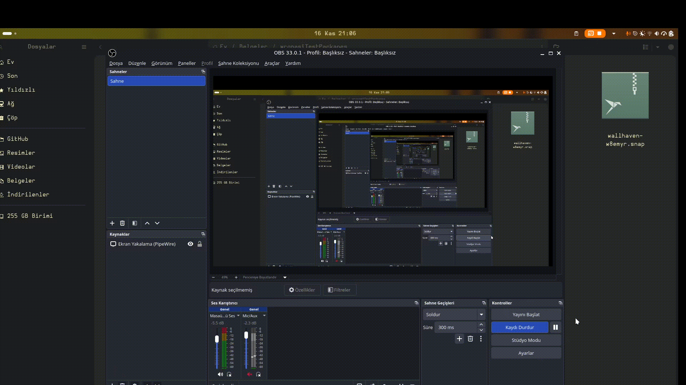

<a href="./README/readmeTr.md">README in TR</a>
 

 

# wropasi (wrong package silly)

> wropasi is currently in alpha state. Which means still got a long way for stable release. Contributes will be appreciated.

wropasi, is an utility that solves an UX problem for the modern and user friendly Linux distributions.

## What does utility actually do?

Let me explain, in a regular user-friendly Linux distributions, when you install a package that doesn't compatible with your package manager (installing .rpm on Linux Mint for an example) then if you try to install it, it will open the app selection dialog that connected to your desktop enviroment or just will open your archive manager.

And this can be confusing for an new Linux user, because on Windows or MacOS you need to install just one package management. This is a problem because Linux has so many package maneger and package format. wropasi targets to solve this problem.

## How it is wropasi solves the problem?

wropasi, approach the problem with 2 simple method: **Inform the User** and **Guide the User**

With **Inform the User** method, we first want to inform the user that installed package isn't compatible with their system. wropasi will inform the user with nice and understandable text and symbolic image. Now the user knows that their system can't install the current package. But without any **Guide**, means leaving the user in the lurch.

And the **Guide the User** method solves that. After the text and symbolic images, now we give a few options to the user with the package, according to their native package management and the package format that they currently trying to install. Searching the package in distributions repositories, searching on flatpak or snap, converting to .deb & .rpm with alien and a few other for other package management. With this method, now the user informed and knows what to do. Bam!

## Screenshots

## Development

wropasi is currently in **alpha** state, which means the app is working but i need to finish localization integration, properly check all the both Turkish and English strings and package it to .deb and .rpm packages. Then we can talk about an stable release.

You can help me by adding new PM handlers, (located at app/src/wropasi/formats), polish and check the existing ones, **try wropasi in your own system**, do localization for your language and creating a .deb package because i dont know how to package debs.

Found a thing? If you can fix yourself own, just make an pull request properly. If you cant just create a issue.

## Large Language Model (AI) Usage Disclosure

Yes, i did use Large Language Models (AI) for this project. So you can call this project aislop if you want. But firstly, lets take a look that where and which AI models that we use in this software.

### Which AI models used?

These AI models used in this project:
From **the agy** (Antigravity CLI) interface:
    - **Gemini 3.8 Flash**
    - **Claude Sonnet 5.5 & Opus 5.5**

### Which parts created by the AI models in this project?

    - Obviously, the source code of the software
    - project tree
    - Localization Integration (i18n)
    - All thingies in **po** and **app** dirs

### Which parts did not created by the AI models in this project?

    - Basic algorithm of the software (Inform and Guide)
    - Logo
    - This README file
    - Javascript Prototype
    - All strings in the project
    - Turkish and English localization
    - .rpm and .deb packages of the software

and thats it.

## License

wropasi, licensed with GPL-3.0 License. Check the LICENSE file for more information.

Icons that used on logo:

[Question icons created by Magnific - Flaticon](https://www.flaticon.com/free-icons/question "question icons")

[Alert icons created by Magnific - Flaticon](https://www.flaticon.com/free-icons/alert "alert icons")

[Road signs icons created by Jesus Chavarria - Flaticon](https://www.flaticon.com/free-icons/road-signs "road signs icons")
